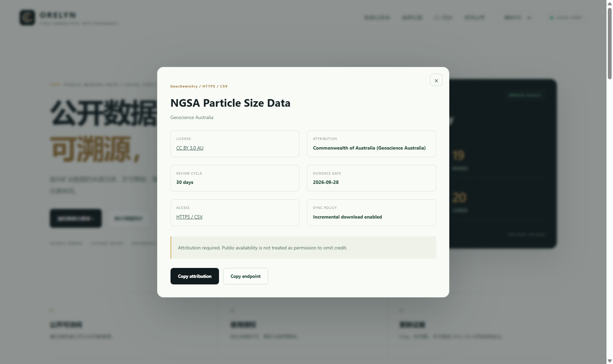

# ORELYN：一个本地优先的公开数据增量同步与溯源工具

> 作者：LUCIA LEE（李镜馨）  
> 标签：独立研究与软件开发｜空间数据  
> 关键词：空间数据、数据治理、增量同步、断点续传、ETag、Range、数据溯源

## 为什么做这个工具

公开数据项目中，真正麻烦的往往不是“能不能下载”，而是以下三件事：

1. 数据更新时是否还要全量重拉；
2. 下载中断后，已有部分是否还能安全续传；
3. 数据来源、许可、更新过程是否还能被复核。

ORELYN 是一个本地优先的小型工具，用 Python 标准库实现增量监控和断点续传，同时提供一个无需部署的离线 HTML 页面，用于查看数据源注册表、许可信息、同步状态和项目证据。



## 数据来源与许可分别处理

当前注册表包含 8 个真实数据源，其中 4 个支持直接增量下载，3 个只用于有界服务查询，1 个因为许可元数据仍需复核而禁止自动下载。

每条记录包含：

- 发布机构与数据集名称；
- 官方访问端点；
- 访问方式（HTTPS、WFS、STAC）；
- 许可类型与许可链接；
- 署名要求；
- 证据日期与复核周期；
- 是否允许自动同步。

这里有一条明确原则：**公开可访问不等于可以任意使用，服务在线也不等于允许批量抓取。**

## 增量监控：先判断有没有变化

CLI 使用 ETag 和 Last-Modified 进行条件请求。未变化时，服务端返回 304，工具跳过下载：

```python
if previous.get("etag"):
    headers["If-None-Match"] = previous["etag"]
if previous.get("lastModified"):
    headers["If-Modified-Since"] = previous["lastModified"]
```

实测中，同一个 GA 数据源第一次下载为 1,642,356 字节，第二次请求返回 `unchanged`，没有再次传输完整文件。

## 断点续传：不能只处理 Range 成功的情况

如果本地存在 `.part` 文件，下一次请求会从当前字节偏移继续：

```python
headers["Range"] = f"bytes={offset}-"
```

但服务端可能忽略 Range，直接返回 200。此时不能把完整响应追加到旧文件后面，否则会得到一个重复拼接的损坏文件。

当前实现只有两种安全路径：

```text
206 Partial Content → 从本地偏移继续写入
200 OK（忽略 Range） → 放弃本次偏移，从字节零重新下载
```

`416 Range Not Satisfiable` 也会进入重新检查流程，绝不会把旧部分直接标记为完成。

## 续传时，SHA-256 必须包含已有部分

一个容易犯的错误是：续传时只计算新写入内容的哈希，然后把这个哈希当作整文件哈希。

正确做法是先读入已有部分，再持续更新：

```python
digest = hashlib.sha256()
if offset:
    with partial.open("rb") as existing:
        for chunk in iter(lambda: existing.read(CHUNK_SIZE), b""):
            digest.update(chunk)
```

只有完整响应结束后，`.part` 才会被移动为正式文件，并写入 SHA-256、字节数、ETag、完成时间等状态。完成件按只读方式保存，新版本替换前会归档旧版本。

## 本地状态与离线展示

同步状态保存在 `registry-state.json`，包括：

- 最近检查时间；
- 端点可用性；
- 下载字节数；
- SHA-256；
- ETag / Last-Modified；
- 是否经历了续传。

离线 HTML 页面支持手动载入这个文件。它只在浏览器本地读取，不会上传到任何服务器。

```text
python cli.py check
python cli.py sync --source ga-particle-size
python cli.py status
python cli.py watch --interval-hours 24
```

默认监控间隔为 24 小时，避免高频请求。`watch` 只是用户主动启动的低频循环，不是云端 7×24 常驻服务。

## 当前验证结果

- 7 项同步与许可测试通过；
- Range 续传、忽略 Range、304、旧版归档和许可门控均有本地模拟服务测试；
- 真实 GA 数据同步与二次 `unchanged` 验证通过；
- 离线桌面和移动端检查通过；
- 单文件 HTML 可以直接双击打开，不需要域名或部署。

## 当前边界

ORELYN 目前不是公共数据再分发平台，也不是法律授权判断工具。许可元数据用于辅助复核，实际复用仍需查看提供方最新条款。

部分 WFS 服务在当前网络下不可用，状态快照会如实记录，不会把“注册过数据源”包装成“服务始终在线”。

项目源码、独立 HTML 和本地分发包已整理到 GitHub（发布时补充实际仓库链接）。欢迎围绕增量同步、断点续传、许可元数据和低频更新策略交流。

---

作者：**LUCIA LEE（李镜馨）**  
标签：**独立研究与软件开发｜空间数据**  
联系：**lijingxin.geo@outlook.com**
